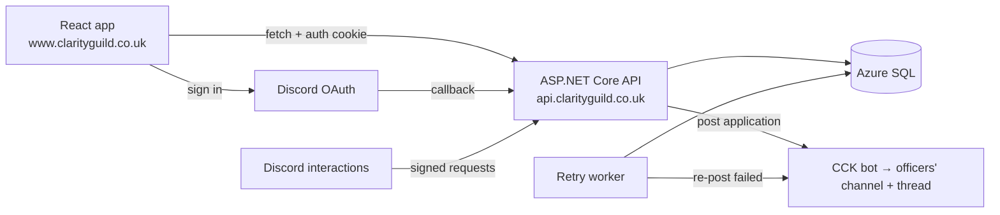

# Clarity Guild Website

[](https://github.com/cckraken/ClarityGuildWebsite/actions/workflows/Dev.yaml)

A recruitment site for **Clarity**, a World of Warcraft raiding guild. Applicants sign in with Discord and apply; the API stores the application and a custom Discord bot posts it for officers to discuss.

**Live:** https://www.clarityguild.co.uk

## Why it exists

Applications used to go Google Form → Apps Script → Discord webhook. The webhook sometimes failed **silently**, so the only safety net was manually checking a spreadsheet every other day, and there was no verified way to know who an applicant was on Discord.

This replaces that with:
- **Verified identity**: applicants sign in with Discord, so officers know exactly who applied.
- **Nothing lost**: every application is stored first, and delivery to Discord is tracked and retried automatically.
- **Less admin**: the bot posts each application with a discussion thread and pings the officers.

## Features

- Discord OAuth sign-in on the application form
- Form validation on both sides (Zod in the browser, data annotations on the API), with drafts saved in the browser so nothing is lost if sign-in expires
- Applications posted to Discord by a custom bot (CCK), with a discussion thread and an officer ping
- Delivery tracking (Pending / Delivered / Failed / Abandoned) with a background retry worker
- Automatic deletion of applications after 3 months, matching the privacy notice
- Signature-verified Discord interactions endpoint (the foundation for officer actions)
- Security: CSRF protection via an Origin check, cookie auth with SameSite=Lax, validated post-login redirects, per-IP rate limiting on submissions

## Tech stack

| Area | Tech |
|---|---|
| API | ASP.NET Core Web API (.NET 10), Entity Framework Core |
| Frontend | React 19, TypeScript, Vite, Tailwind CSS v4, react-hook-form, Zod |
| Data | Azure SQL (Entra ID authentication via managed identity) |
| Discord | Discord.Net (REST), AspNet.Security.OAuth.Discord |
| Hosting | Azure App Service (API), Azure Static Web Apps (frontend), Application Insights |
| CI/CD | GitHub Actions |
| Tests | xUnit |

## Architecture



## Key decisions

- **Cookie authentication on same-site subdomains** (www. and api.), rather than tokens stored in the browser. The cookie is HttpOnly, so page scripts can't read it, and SameSite=Lax limits when it's sent.
- **Identity comes only from the sign-in cookie**, never from the request body, so an applicant can't submit as someone else.
- **Store first, then post, with a background retry**, rather than relying on a single call. Duplicates are acceptable; missed applicants aren't.
- **Non-sequential public IDs in URLs** alongside integer database keys, so applications can't be found by guessing numbers.
- **An Origin-check middleware for CSRF protection** rather than antiforgery tokens: fewer moving parts for a single-page app with a fixed list of origins.

## Running locally

**Prerequisites:** .NET 10 SDK, Node.js (LTS), SQL Server LocalDB (included with Visual Studio).

1. **Secrets** (in ClarityGuildWebsite.Api):
   ```
   dotnet user-secrets set "Discord:BotToken" "<your bot token>"
   dotnet user-secrets set "Discord:ClientSecret" "<your OAuth client secret>"
   ```
2. **Database:**
   ```
   dotnet ef database update
   ```
3. **API:**
   ```
   dotnet run --launch-profile https
   ```
   Runs at https://localhost:7259.
4. **Frontend** (in ClarityGuildWebsite.Web):
   ```
   npm install
   npm run dev
   ```
   Runs at http://localhost:5173.

**Tests:** dotnet test

## CI/CD

- **CI:** every push and pull request to main builds and tests the API, and lints and builds the frontend. main is protected: changes go through pull requests, and both checks must pass.
- **Frontend deploy:** after CI succeeds on main, the build it produced is deployed to Azure Static Web Apps.
- **API deploy:** currently manual. Automated deployment is next on the roadmap.

## Roadmap

- [x] Application form, storage and Discord delivery with retries
- [x] Discord sign-in
- [x] Automatic data retention
- [ ] Officers can request more information from an applicant by DM, with replies posted to the thread
- [ ] Approve button: trial role and welcome message
- [ ] Automated API deployment
- [ ] Integration tests
- [ ] Officer control panel
