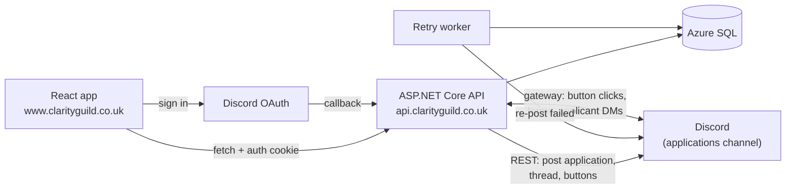

# Clarity Guild Website

[](https://github.com/cckraken/ClarityGuildWebsite/actions/workflows/Dev.yaml)

A recruitment site for **Clarity**, a World of Warcraft raiding guild. Applicants sign in with Discord and apply; the API stores the application, and a custom Discord bot (CCK) posts it for the Recruitment Team, who can message, approve or decline the applicant without leaving Discord.

**Live:** https://www.clarityguild.co.uk

## Why it exists

Applications used to go Google Form → Apps Script → Discord webhook. The webhook sometimes failed **silently**, so the only safety net was manually checking a spreadsheet every other day, and there was no verified way to know who an applicant was on Discord. Following up meant officers DMing applicants from their own accounts, with the conversation scattered across people.

This replaces that with:
- **Verified identity**: applicants sign in with Discord, so the team knows exactly who applied.
- **Nothing lost**: every application is stored first, and delivery to Discord is tracked and retried automatically.
- **One place for everything**: each application gets its own thread, and every message, reply and decision is recorded there.

## Features

- Discord OAuth sign-in on the application form
- Form validation on both sides (Zod in the browser, data annotations on the API), with drafts saved in the browser so nothing is lost if sign-in expires
- Applications posted by CCK with a discussion thread, action buttons and a Recruitment Team ping
- **Message Applicant**: the bot DMs the applicant; their replies (including screenshots) are relayed into the thread
- **Approve**: adds the Trial role and posts an editable welcome that highlights chosen channels
- **Decline**: a reason (plus an optional note) is sent to the applicant by DM
- Access limited to the Recruitment Team's roles, checked on every click and submit
- Delivery tracking (`Pending` / `Delivered` / `Failed` / `Abandoned`) with a background retry worker
- Automatic deletion of applications after 3 months, matching the privacy notice
- Security: CSRF protection via an Origin check, cookie auth with `SameSite=Lax`, validated post-login redirects, per-IP rate limiting on submissions, and applicant text posted without mentions

## Tech stack

| Area | Tech |
|---|---|
| API | ASP.NET Core Web API (.NET 10), Entity Framework Core |
| Frontend | React 19, TypeScript, Vite, Tailwind CSS v4, react-hook-form, Zod |
| Data | Azure SQL (Entra ID authentication via managed identity) |
| Discord | Discord.Net (gateway + REST), AspNet.Security.OAuth.Discord |
| Hosting | Azure App Service (API), Azure Static Web Apps (frontend), Application Insights |
| CI/CD | GitHub Actions |
| Tests | xUnit |

## Architecture



## Key decisions

- **Cookie authentication on same-site subdomains** (`www.` and `api.`), rather than tokens stored in the browser. The cookie is `HttpOnly`, so page scripts can't read it, and `SameSite=Lax` limits when it's sent.
- **Identity comes only from the sign-in cookie**, never from the request body, so an applicant can't submit as someone else.
- **Store first, then post, with a background retry**, rather than relying on a single call. Duplicates are acceptable; missed applicants aren't.
- **Non-sequential public IDs in URLs** alongside integer database keys, so applications can't be found by guessing numbers.
- **An Origin-check middleware for CSRF protection** rather than antiforgery tokens: fewer moving parts for a single-page app with a fixed list of origins.
- **A gateway connection for the bot** rather than an HTTP interactions endpoint, because receiving applicants' DM replies requires the gateway anyway. One entry point for everything, at the cost of needing an always-on single instance.
- **Save before side effects**: a decision is saved to the database before the applicant is messaged, because a database write can be retried and a sent DM can't be taken back.

## Running locally

**Prerequisites:** .NET 10 SDK, Node.js (LTS), SQL Server LocalDB (included with Visual Studio), and a test Discord bot + server.

1. **Secrets** (in `ClarityGuildWebsite.Api`):
   ```
   dotnet user-secrets set "Discord:BotToken" "<your bot token>"
   dotnet user-secrets set "Discord:ClientSecret" "<your OAuth client secret>"
   ```
2. **Discord IDs:** set your test server's IDs in `appsettings.Development.json` (`GuildId`, `ApplicationsChannelId`, `RaidersChatId`, `TrialRoleId`, `RecruitmentTeamRoleIds`, `DefaultWelcomeChannelIds`, `ClientId`).
3. **Database:**
   ```
   dotnet ef database update
   ```
4. **API:**
   ```
   dotnet run --launch-profile https
   ```
   Runs at https://localhost:7259.
5. **Frontend** (in `ClarityGuildWebsite.Web`; `.env.development` sets `VITE_API_BASE_URL` and `VITE_DISCORD_INVITE_URL`):
   ```
   npm install
   npm run dev
   ```
   Runs at http://localhost:5173.

**Tests:** `dotnet test`

## CI/CD

- **CI:** every push and pull request to `main` builds and tests the API, and lints and builds the frontend. `main` is protected: changes go through pull requests, and both checks must pass.
- **Frontend deploy:** after CI succeeds on `main`, the build it produced is deployed to Azure Static Web Apps. A manual workflow deploys any branch to the dev environment.
- **API deploy:** currently manual (migration script first, then publish). Automated deployment is next on the roadmap.
- **Environments:** a separate dev environment (its own API, database, frontend and test bot) for testing changes end to end before production.

## Roadmap

- [x] Application form, storage and Discord delivery with retries
- [x] Discord sign-in
- [x] Automatic data retention
- [x] Message applicants by DM, with replies relayed to the thread
- [x] Approve (Trial role + welcome) and Decline (reason by DM)
- [ ] Validate all configuration at startup (Options pattern)
- [ ] Optimistic concurrency for simultaneous decisions
- [ ] Automated API deployment
- [ ] Integration tests
- [ ] Retention for application data stored in Discord
- [ ] Officer control panel
